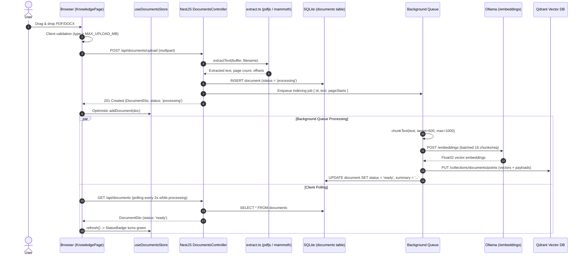

# Architecture Documentation

Doc Assistant is a local-first, provider-agnostic Document RAG application implemented as an **npm-workspaces monorepo** with a React 19 Single Page Application frontend and a lightweight NestJS API service.

---

## 1. Monorepo Structure

```
doc-assistant/
├─ package.json            # npm workspaces: ["apps/*"]; root build/test/lint scripts
├─ apps/api/               # doc-api: NestJS REST + SSE backend
│   └─ src/
│       ├─ app.module.ts   app.controller.ts (health probe)   main.ts
│       ├─ documents/      # extraction (PDF/DOCX) → chunk → embed → Qdrant vector queue
│       ├─ chat/           # retrieval → prompt assembly → LLM stream → SSE relay
│       └─ lib/            # db.ts (node:sqlite), env.ts (config contract)
├─ apps/web/               # doc-web: React 19 SPA (Vite + Tailwind v4)
│   └─ src/
│       ├─ App.tsx         main.tsx
│       ├─ pages/          # ChatPage · KnowledgePage · LibraryPage · DocumentDetailPage
│       ├─ components/     # AppShell · Markdown · StatusBadge · Toaster
│       ├─ hooks/          # useChatStream · useDocuments
│       ├─ lib/            # api.ts · constants.ts · types.ts · stores/{documents, sessions}
│       └─ styles/globals.css
├─ e2e/                    # Playwright end-to-end integration tests
├─ data/                   # SQLite database file + vector persistence
├─ docker-compose.yml      # Full multi-container stack (web, api, qdrant, ollama)
├─ Dockerfile              # Multi-stage production build (Node API + Nginx SPA)
└─ .github/workflows/ci.yml # Automated CI pipeline (lint, typecheck, test, coverage)
```

### Architectural Trade-off: Vite + React SPA vs. Next.js

The challenge allows _"Next.js (recommended) or Create React App / Vite + React"_. This project intentionally chose **Vite + React 19** with client-side routing via `react-router`:

- **Purity of Boundary:** All persistent business logic (file extraction, chunking, vector embedding, and prompt construction) belongs behind a thin API. A client SPA keeps this boundary clean, preventing accidental server-component leakage of LLM credentials or unbuffered streams.
- **Instant Client State:** Fast client-side routing means that navigating between Chat, Knowledge, and Document Detail maintains in-memory streaming connections and Zustand stores without hydration overhead or server re-renders.
- **Production Simplicity:** The frontend builds into pure static assets served via Nginx in Docker, while reverse-proxying `/api` requests to the NestJS daemon.

---

## 2. Frontend Component Tree

The following diagram illustrates the presentational vs. container hierarchy, routing boundaries, and shared component bindings across the frontend:

```mermaid
graph TD
    App["App (BrowserRouter, Root Container)"]
    AppShell["AppShell (Header, SkipLink, NavItems, ThemeToggle)"]
    Toaster["Toaster (aria-live Polite Status Region)"]
    Suspense["Suspense (RouteFallback Loader)"]

    App --> AppShell
    App --> Toaster
    App --> Suspense

    Suspense --> ChatPage["ChatPage (Container)"]
    Suspense --> KnowledgePage["KnowledgePage (Container)"]
    Suspense --> LibraryPage["LibraryPage (Container)"]
    Suspense --> DocDetailPage["DocumentDetailPage (Container)"]

    subgraph ChatHierarchy["Chat Page Components"]
        ChatHeader["Chat Header (Session Selector, Scope Picker, New Chat)"]
        MessageList["Message List (Scroll Container)"]
        UserBubble["User Message Bubble"]
        AssistantBubble["Assistant Message Bubble"]
        MarkdownComp["Markdown Renderer (remark-gfm)"]
        CitationChip["Citation Chip (Link to /documents/:id)"]
        TypingDots["TypingDots (Thinking Indicator)"]
        StreamCursor["StreamCursor (Live Blinking Caret)"]
        Suggestions["Empty State Suggestion Chips"]
        Composer["Composer (Dropzone, Auto-expanding Textarea, Send Button, Attach Input)"]
        AttachedList["Attachment Pill List"]

        ChatPage --> ChatHeader
        ChatPage --> Suggestions
        ChatPage --> MessageList
        MessageList --> UserBubble
        MessageList --> AssistantBubble
        AssistantBubble --> MarkdownComp
        MarkdownComp --> CitationChip
        AssistantBubble --> TypingDots
        AssistantBubble --> StreamCursor
        ChatPage --> Composer
        Composer --> AttachedList
    end

    subgraph KnowledgeHierarchy["Knowledge Page Components"]
        KDropzone["Dropzone (Drag-and-Drop, File Browser, Progress Indicator)"]
        KSections["Status Sections (Ingesting, Ready, Errors)"]
        KCard["Document Card (Icon, Title Link, Metadata, Ask CTA, Delete Action)"]
        KSkeleton["SkeletonRows (aria-hidden Loading State)"]
        KBadge["StatusBadge (Solid Variant)"]

        KnowledgePage --> KDropzone
        KnowledgePage --> KSections
        KSections --> KCard
        KCard --> KBadge
        KnowledgePage --> KSkeleton
    end

    subgraph LibraryHierarchy["Library Page Components"]
        LCardGrid["Card Grid (Chat Origin Documents)"]
        LCard["Chat Document Card (Metadata, Delete Action)"]
        LBadge["StatusBadge (Solid Variant)"]
        LSkeleton["SkeletonRows (Loading State)"]

        LibraryPage --> LCardGrid
        LCardGrid --> LCard
        LCard --> LBadge
        LibraryPage --> LSkeleton
    end

    subgraph DetailHierarchy["Document Detail Page Components"]
        DBack["BackLink (Return to Library/Knowledge)"]
        DHeader["Detail Header (Document Title, ID, Metadata)"]
        DBadge["StatusBadge (Soft Variant)"]
        DAskCTA["Ask About This Document (Navigation to Scoped Chat)"]
        DPreview["Preview Container (Extracted Content Scrollbox)"]

        DocDetailPage --> DBack
        DocDetailPage --> DHeader
        DHeader --> DBadge
        DocDetailPage --> DAskCTA
        DocDetailPage --> DPreview
    end
```



---

## 3. End-to-End Data Flow

### 3.1 Document Ingestion & Vector Indexing Flow



### 3.2 Conversational RAG Streaming Flow

```mermaid
sequenceDiagram
    autonumber
    actor User
    participant Chat as Browser (ChatPage)
    participant Hook as useChatStream Hook
    participant API as NestJS ChatController
    participant ChatSvc as ChatService
    participant Qdrant as Qdrant Vector DB
    participant LLM as OpenAI-Compatible LLM (llama.cpp/Ollama)
    participant DB as SQLite (messages table)

    User->>Chat: Type query & press Enter
    Chat->>Hook: send(question, documentIds, attachments)
    Hook->>Chat: Optimistic UI: Append user turn + empty assistant bubble
    Hook->>API: POST /api/chat/stream { question, documentIds, history }
    API->>ChatSvc: initiateCompletion()

    alt Mode == Knowledge (RAG)
        ChatSvc->>ChatSvc: embedQuery(question)
        ChatSvc->>Qdrant: POST /points/search (top_k=6, scoped filter)
        Qdrant-->>ChatSvc: Scored chunk points with metadata
        ChatSvc->>API: Emit SSE frames: event "citation" (payload: docId, title, page, score)
        API-->>Hook: data: {"type":"citation", "doc":"...", "title":"...", "page":2}\n\n
        Hook->>Chat: Inline citation chip mounts in assistant bubble
        ChatSvc->>ChatSvc: buildMessages(prompt with bracketed sources [1]...[6])
    else Mode == Direct (Attached Files)
        ChatSvc->>API: Emit SSE frames: event "citation" (attached doc metadata)
        ChatSvc->>ChatSvc: buildMessagesDirect(full attached document text)
    end

    ChatSvc->>LLM: POST /chat/completions { stream: true, messages, temperature: 0.2 }
    LLM-->>ChatSvc: Token byte chunks (HTTP chunked transfer)

    loop Stream Relay
        ChatSvc->>API: Parse delta token from choice
        API-->>Hook: data: {"type":"chunk", "delta":"..."}\n\n
        Hook->>Chat: Progressive text render + blink StreamCursor
    end

    LLM-->>ChatSvc: [DONE]
    API->>DB: INSERT user & assistant turns (persist transcript)
    API-->>Hook: data: {"type":"done"}\n\n
    Hook->>Chat: Finalize message; remove StreamCursor
```

---

## 4. API Contract Specification

All endpoints are prefixed with `/api`.

### 4.1 Documents Management

#### `POST /api/documents/upload`

Upload a document file for asynchronous ingestion.

- **Content-Type:** `multipart/form-data`
- **Fields:**
  - `file` (Binary, required): File stream (`.pdf`, `.docx`).
  - `title` (String, optional): Custom title override.
- **Responses:**
  - `201 Created`: Returns newly created document row in `processing` state:
    ```json
    {
      "id": "e4b971a8-c287-43de-926b-d8cb8451152a",
      "title": "Annual_Report_2025.pdf",
      "status": "processing",
      "origin": "knowledge",
      "sizeBytes": 2048576,
      "pages": 14,
      "createdAt": "2026-10-27T00:00:00.000Z",
      "progress": { "stage": "indexing", "done": 0, "total": 24 }
    }
    ```
  - `400 Bad Request`: File type unsupported or exceeds `MAX_UPLOAD_MB`.

#### `GET /api/documents`

List documents in the library.

- **Query Parameters:**
  - `origin` (Optional, string): Filter by `"knowledge"` or `"chat"`. When omitted, returns all documents.
- **Response:**
  - `200 OK`: Array of `DocumentDto` objects.

#### `DELETE /api/documents/:id`

Remove a document. If `origin == "knowledge"`, all related vector points are purged from Qdrant.

- **Responses:**
  - `204 No Content`: Successfully deleted.
  - `404 Not Found`: Document ID does not exist.

---

### 4.2 Conversational Q&A & Streaming

#### `POST /api/chat/stream`

Open an SSE streaming channel for grounded conversational answers.

- **Content-Type:** `application/json`
- **Request Body:**
  ```json
  {
    "question": "What were the main revenue drivers described on page 4?",
    "documentIds": ["e4b971a8-c287-43de-926b-d8cb8451152a"],
    "sessionId": "a8274d81-8b54-4a57-8dfc-e09f58fa996e",
    "history": [
      { "role": "user", "content": "Hello" },
      { "role": "assistant", "content": "How can I help you today?" }
    ]
  }
  ```
- **Response Headers:**
  - `Content-Type: text/event-stream`
  - `Cache-Control: no-cache`
  - `Connection: keep-alive`
- **SSE Event Frame Protocol (`data: <json>\n\n`):**
  1. **Citation Events** (emitted before text tokens):
     ```json
     data: {"type":"citation","doc":"e4b971a8-...","title":"Report.pdf","page":4,"score":0.89}
     ```
  2. **Chunk Events** (progressive token stream):
     ```json
     data: {"type":"chunk","delta":"According"}
     data: {"type":"chunk","delta":" to"}
     data: {"type":"chunk","delta":" the report [1]..."}
     ```
  3. **Terminal Event** (completion):
     ```json
     data: {"type":"done"}
     ```
  4. **In-Band Error Event** (if upstream LLM fails mid-stream):
     ```json
     data: {"type":"error","reason":"LLM generation timed out."}
     ```

#### `GET /api/health`

Liveness probe utilized by Docker Compose and orchestration health checks.

- **Response `200 OK`:** `{"status":"ok"}`

---

## 5. State Management Architecture

Shared application state is managed using **Zustand v5** with the curried `create<T>()((set, get) => ...)` pattern.

### Two Dedicated Stores

1. **`useDocumentsStore` (`lib/stores/documents.ts`):**
   - **State:** `documents: Document[]`, `loaded: boolean`, `error: string | null`.
   - **Actions:** `load()`, `refresh()`, `addDocument(doc)`, `removeDocument(id)`.
   - **Selectors:** `selectByOrigin(docs, origin)` returns stable filtered arrays so components re-render only when relevant documents change.
2. **`useSessionsStore` (`lib/stores/sessions.ts`):**
   - **State:** `sessions: Session[]`, `activeId: string | null`, `messages: Message[]`.
   - **Actions:** `newSession()`, `switchSession(id)`, `appendUserMessage(text)`, `updateStreamingBubble(delta, citations)`.

### State Lifecycle & Route Transitions

Because state is maintained in external store closures outside the React component tree:

- Navigating away from `ChatPage` to inspect a document on `DocumentDetailPage` and returning preserves the conversation history and active stream.
- In contrast, clicking **"Ask about this"** on `KnowledgePage` or `DocumentDetailPage` explicitly passes `?docId=<id>` in the route, triggering a fresh conversation session reset (`newConversation()`) scoped directly to that document, preventing cross-document conversational pollution.
- Ingestion progress remains actively tracked across page changes without re-triggering network cascades.
