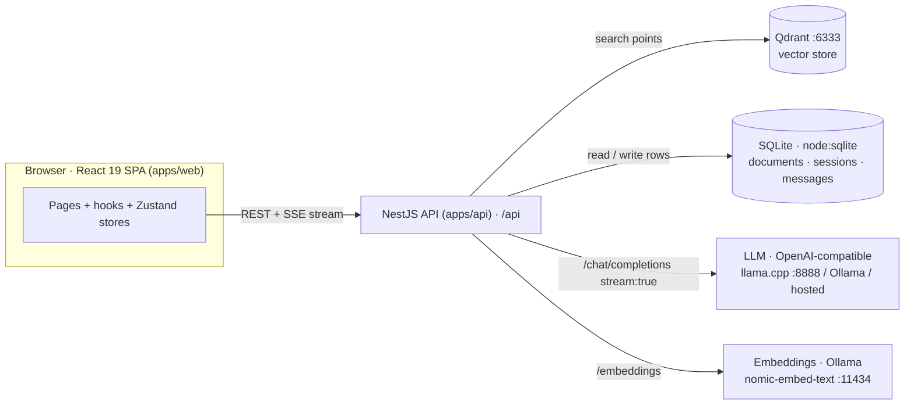

# Doc Assistant

An AI-powered document assistant: upload PDFs or DOCX files, ask questions in natural language, and receive **accurate, cited answers streamed token-by-token** — with every answer grounded in your own documents via retrieval-augmented generation (RAG).

Built as a local-first full-stack app: a React 19 frontend, a thin NestJS API, and a pluggable LLM layer that runs against llama.cpp, Ollama, or any OpenAI-compatible endpoint. No data leaves the machine unless you point it at a hosted model.

## Features

- **Document library** — drag-and-drop or click-to-upload for PDF/DOCX, live per-file status (uploading → processing → ready / error), metadata (name, size, page count, upload date), and one-click removal.
- **Conversational Q&A** — Enter to send, Shift+Enter for a newline; progressive streaming; inline citations that link each answer back to the source document and page; persistent conversation history with new/previous sessions.
- **Two answering modes** — _Knowledge_ (RAG over your whole corpus) and _Direct_ (ask about specific attached documents without retrieval), both streamed.
- **Accessible, themeable UI** — WCAG 2.1 AA-minded design system in oklch tokens, persisted light/dark theme, keyboard navigable, reduced-motion safe, responsive layout with meaningful empty/loading/error states.

## Architecture at a glance



Two flows drive the system:

- **Upload (Knowledge):** `web → POST /api/documents/upload` → extract text (`pdfjs-dist` for PDF, `mammoth` for DOCX) → chunk → embed via Ollama → upsert points into Qdrant. Indexing runs in a background queue so the upload returns immediately with live progress.
- **Question:** `web → POST /api/chat/stream` → embed the question → retrieve top-k from Qdrant → build a context-grounded prompt → call the LLM with `stream: true` → relay deltas to the browser as Server-Sent Events (`citation* → chunk* → done | error`).

See [ARCHITECTURE.md](ARCHITECTURE.md) for the full module breakdown, data flow, and error handling.

## Quick start

Node **22+** required (the API uses the built-in `node:sqlite` module).

### Option A — Docker Compose (fastest)

Brings up Ollama (embeddings + chat), Qdrant, the API, and the web UI in one command. The embedding model is pulled automatically; the chat model is pulled once.

```bash
docker compose up --build                 # builds both images on first run
# pull the chat model into Ollama (once):
docker compose exec ollama ollama pull qwen2.5:7b-instruct-q4_K_M
```

Then open **http://localhost:8080** (nginx serves the SPA and proxies `/api` to the API on `:3001`).

> Compose runs chat _and_ embeddings through Ollama's OpenAI-compatible endpoint. To use llama.cpp or a hosted model instead, set `LLM_BASE_URL` / `LLM_MODEL` / `LLM_API_KEY` in `docker-compose.yml`.

### Option B — Local dev stack (hot reload)

Start the backing services first (if they aren't already running):

```bash
ollama serve                              # :11434  →  ollama pull nomic-embed-text
# llama.cpp server on :8888 serving an OpenAI-compatible /v1 endpoint (chat model)
# Qdrant on :6333
```

Then run the app:

```bash
npm install                               # once, at repo root (installs all workspaces)
cp apps/api/.env.example apps/api/.env    # set LLM_BASE_URL / LLM_MODEL to your provider
npm run build                             # typechecks + bundles both apps (API needs dist/)
npm run dev:web                           # SPA on :5173, proxies /api → :3001   (terminal 1)
npm run dev:api                           # API on :3001 (global prefix /api)     (terminal 2)
```

Open **http://localhost:5173**. A liveness probe is available at `GET /api/health`.

## Running tests

Three layers, all runnable from the repo root:

| Layer            | Command                                             | What it does                                                                       |
| ---------------- | --------------------------------------------------- | ---------------------------------------------------------------------------------- |
| Unit (both apps) | `npm test`                                          | Vitest suites for `apps/web` (React Testing Library + jsdom) and `apps/api` (Node) |
| Coverage gates   | `npm run test:coverage -w doc-web` and `-w doc-api` | Enforces **≥ 80 % on statements, branches, functions, and lines** in _both_ apps   |
| End-to-end       | `npm run test:e2e`                                  | Playwright drives the real upload → question flow against a live stack             |

CI (GitHub Actions) runs lint, type-check, unit tests, and both coverage gates on every push. See [TESTING.md](TESTING.md) for strategy, what is covered, and known gaps.

## Configuration

All configuration is environment-driven; the API reads `apps/api/.env` via Node's `--env-file`. A documented template lives at [`apps/api/.env.example`](apps/api/.env.example).

| Variable                             | Purpose                         | Default / notes                                                |
| ------------------------------------ | ------------------------------- | -------------------------------------------------------------- |
| `PORT`                               | API listen port                 | `3001`                                                         |
| `DATABASE_PATH`                      | SQLite file location            | `data/doc-assistant.db`                                        |
| `LLM_BASE_URL`                       | OpenAI-compatible chat endpoint | llama.cpp `:8888/v1`, Ollama `:11434/v1`, or a hosted base URL |
| `LLM_MODEL`                          | Chat model name / id            | e.g. `qwen2.5:7b-instruct-q4_K_M`                              |
| `LLM_API_KEY`                        | Bearer key                      | optional — only sent when set (local servers ignore it)        |
| `EMBED_BASE_URL`                     | Embeddings endpoint             | defaults to Ollama                                             |
| `EMBED_MODEL`                        | Embedding model                 | `nomic-embed-text`                                             |
| `LLM_TEMPERATURE` / `LLM_MAX_TOKENS` | Sampling + length               | `0.2` / `1024`                                                 |
| `QDRANT_BASE_URL`                    | Vector store                    | `:6333`                                                        |
| `MAX_UPLOAD_MB`                      | Upload size limit               | `10`                                                           |

The web app needs no client-side env vars in dev (Vite proxies `/api`); see [`apps/web/.env.example`](apps/web/.env.example).

## Design & architecture decisions

- **[ARCHITECTURE.md](ARCHITECTURE.md)** — monorepo layout, API module breakdown, the SSE streaming protocol, frontend state architecture, and end-to-end error handling.
- **[DESIGN.md](DESIGN.md)** — the design system (oklch tokens, theming), component architecture, accessibility approach, and per-view state coverage.

## Known limitations

Honest list of what is not yet in place:

- **No embedded PDF passage viewer** — citations link to the source document's detail view; there is no in-PDF scroll-to-and-highlight of the cited passage.
- **No model picker in the UI** — the chat model is fixed via `LLM_MODEL`; switching requires a config change, not a dropdown.
- **Snapshot / visual-regression and jest-axe accessibility suites are present as dependencies but not wired into the default test run** — see [TESTING.md](TESTING.md).
- **Responsive support is fluid (layout reflows, the nav wraps) but has no dedicated mobile navigation menu**, and no measured Lighthouse performance budget.

## Innovation assessment

A first-person engineering essay on the most interesting decisions in this build — local-first RAG with live streaming and inline citations, single-source-of-trust state that survives route changes, provider-agnostic LLM integration, and graceful degradation — lives in [INNOVATION_ASSESSMENT.md](INNOVATION_ASSESSMENT.md).

## Structure

| Path       | Purpose                                                                                                               |
| ---------- | --------------------------------------------------------------------------------------------------------------------- |
| `apps/api` | NestJS service — REST for library state + sessions, SSE stream endpoint for chat answers (`/api`)                     |
| `apps/web` | React 19 SPA — Knowledge / Chat / Library / Document-detail views, Tailwind v4 oklch tokens, dark/light via CSS class |
| `data/`    | SQLite file (documents · sessions · messages) + Ollama model cache                                                    |

## Milestones

M1 scaffold · M2 ingestion/upload · M3 streaming + citations · M4 polish · M6 Docker/CI/docs

## Docs

Project docs and specs live in [docs/](docs/README.md) — project context, engineering standards, development plan, working memory, and the spec index. Per-app specs mirror each `src/`:

- API: [apps/api/docs/spec/](apps/api/docs/spec/README.md)
- Web: [apps/web/docs/spec/](apps/web/docs/spec/README.md)
