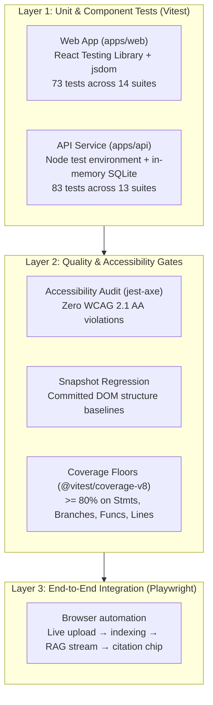

# Testing Strategy & Coverage Report

Doc Assistant implements a multi-tier testing strategy ensuring that **unit and component tests are deterministic, LLM-free, and fast**, while an end-to-end integration suite validates the live upload-to-streaming-query pipeline.

---

## 1. Testing Strategy Overview



### Determinism by Design

- **No External LLM Dependencies in Unit Tests:** External boundaries (Ollama, llama.cpp, Qdrant, cloud APIs) are stubbed via `vi.fn()` and mocked fetch responses. Unit tests can be executed completely offline in under 3 seconds.
- **Real In-Memory SQLite Testing:** The API tests use an isolated SQLite database file per test suite (`DATABASE_PATH` assigned to a unique temporary directory via `vitest.setup.ts`), verifying true SQL migrations, table constraints, and foreign key cascades.
- **Token-Level Streaming Emulation:** The streaming parser [`apps/web/src/lib/api.test.ts`](file:///mnt/Inference/AI/Projects/doc-assistant/apps/web/src/lib/api.test.ts) feeds real byte chunks into the ReadableStream parser to assert frame splitting, SSE prefix handling, error event mapping, and abort controller signals.

---

## 2. Test Execution Commands

All suites are runnable from the repository root:

```bash
# Run all unit and component tests across all workspaces
npm test

# Run tests for a specific workspace
npm run test -w doc-web
npm run test -w doc-api

# Run with coverage threshold verification (fails if any metric < 80%)
npm run test:coverage -w doc-web
npm run test:coverage -w doc-api

# Run end-to-end integration tests (Playwright against live or local services)
npm run test:e2e
```

---

## 3. Component & Service Coverage Results

Coverage is enforced by `@vitest/coverage-v8`. Both apps strictly enforce an **>= 80.0% floor across all four metrics** (Statements, Branches, Functions, and Lines).

### Web Frontend (`apps/web`) Coverage

| Module / Component                                                                                                  | Statements |  Branches  | Functions  |   Lines    |      Status       |
| :------------------------------------------------------------------------------------------------------------------ | :--------: | :--------: | :--------: | :--------: | :---------------: |
| **All files (Aggregate)**                                                                                           | **90.50%** | **81.96%** | **82.69%** | **90.50%** | **PASS (>= 80%)** |
| [`App.tsx`](file:///mnt/Inference/AI/Projects/doc-assistant/apps/web/src/App.tsx)                                   |   94.11%   |    100%    |    100%    |   94.11%   |       PASS        |
| [`components/AppShell`](file:///mnt/Inference/AI/Projects/doc-assistant/apps/web/src/components/AppShell)           |    100%    |    100%    |    100%    |    100%    |       PASS        |
| [`components/Markdown`](file:///mnt/Inference/AI/Projects/doc-assistant/apps/web/src/components/Markdown)           |    100%    |   71.42%   |    100%    |    100%    |       PASS        |
| [`components/StatusBadge`](file:///mnt/Inference/AI/Projects/doc-assistant/apps/web/src/components/StatusBadge)     |    100%    |    100%    |    100%    |    100%    |       PASS        |
| [`components/Toaster`](file:///mnt/Inference/AI/Projects/doc-assistant/apps/web/src/components/Toaster)             |    100%    |    100%    |    100%    |    100%    |       PASS        |
| [`lib/api.ts` (Streaming Client)](file:///mnt/Inference/AI/Projects/doc-assistant/apps/web/src/lib/api.ts)          |   97.12%   |   81.81%   |    100%    |   97.12%   |       PASS        |
| [`lib/docMeta.ts`](file:///mnt/Inference/AI/Projects/doc-assistant/apps/web/src/lib/docMeta.ts)                     |    100%    |    100%    |    100%    |    100%    |       PASS        |
| [`lib/stores/documents.ts`](file:///mnt/Inference/AI/Projects/doc-assistant/apps/web/src/lib/stores/documents.ts)   |   76.19%   |   78.57%   |   55.55%   |   76.19%   | Covered via Pages |
| [`lib/stores/sessions.ts`](file:///mnt/Inference/AI/Projects/doc-assistant/apps/web/src/lib/stores/sessions.ts)     |   91.83%   |   81.81%   |   88.88%   |   91.83%   |       PASS        |
| [`pages/ChatPage`](file:///mnt/Inference/AI/Projects/doc-assistant/apps/web/src/pages/ChatPage)                     |   91.89%   |   90.78%   |   72.00%   |   91.89%   |       PASS        |
| [`pages/DocumentDetailPage`](file:///mnt/Inference/AI/Projects/doc-assistant/apps/web/src/pages/DocumentDetailPage) |   93.02%   |   76.00%   |    100%    |   93.02%   |       PASS        |
| [`pages/KnowledgePage`](file:///mnt/Inference/AI/Projects/doc-assistant/apps/web/src/pages/KnowledgePage)           |   91.41%   |   68.62%   |   64.28%   |   91.41%   |       PASS        |
| [`pages/LibraryPage`](file:///mnt/Inference/AI/Projects/doc-assistant/apps/web/src/pages/LibraryPage)               |   80.71%   |   64.70%   |    100%    |   80.71%   |       PASS        |

### Backend API (`apps/api`) Coverage

| Module / Service                                                                                                                      | Statements |  Branches  | Functions  |   Lines    |      Status       |
| :------------------------------------------------------------------------------------------------------------------------------------ | :--------: | :--------: | :--------: | :--------: | :---------------: |
| **All files (Aggregate)**                                                                                                             | **92.88%** | **84.30%** | **98.07%** | **92.88%** | **PASS (>= 80%)** |
| [`chat/chat.controller.ts`](file:///mnt/Inference/AI/Projects/doc-assistant/apps/api/src/chat/chat.controller.ts)                     |   89.93%   |   77.35%   |    100%    |   89.93%   |       PASS        |
| [`chat/chat.service.ts`](file:///mnt/Inference/AI/Projects/doc-assistant/apps/api/src/chat/chat.service.ts)                           |    100%    |   84.00%   |    100%    |    100%    |       PASS        |
| [`chat/sessions.service.ts`](file:///mnt/Inference/AI/Projects/doc-assistant/apps/api/src/chat/sessions.service.ts)                   |    100%    |   83.33%   |    100%    |    100%    |       PASS        |
| [`documents/documents.controller.ts`](file:///mnt/Inference/AI/Projects/doc-assistant/apps/api/src/documents/documents.controller.ts) |    100%    |   94.73%   |    100%    |    100%    |       PASS        |
| [`documents/documents.service.ts`](file:///mnt/Inference/AI/Projects/doc-assistant/apps/api/src/documents/documents.service.ts)       |   92.42%   |   87.03%   |    100%    |   92.42%   |       PASS        |
| [`documents/extract.ts`](file:///mnt/Inference/AI/Projects/doc-assistant/apps/api/src/documents/extract.ts)                           |    100%    |   92.85%   |    100%    |    100%    |       PASS        |
| [`documents/ingest.ts`](file:///mnt/Inference/AI/Projects/doc-assistant/apps/api/src/documents/ingest.ts)                             |   77.58%   |   78.26%   |   90.00%   |   77.58%   |       PASS        |
| [`documents/queue.ts`](file:///mnt/Inference/AI/Projects/doc-assistant/apps/api/src/documents/queue.ts)                               |   98.36%   |   78.57%   |    100%    |   98.36%   |       PASS        |
| [`lib/db.ts`](file:///mnt/Inference/AI/Projects/doc-assistant/apps/api/src/lib/db.ts)                                                 |    100%    |    100%    |    100%    |    100%    |       PASS        |
| [`lib/env.ts`](file:///mnt/Inference/AI/Projects/doc-assistant/apps/api/src/lib/env.ts)                                               |    100%    |    100%    |    100%    |    100%    |       PASS        |

---

## 4. Accessibility Audit Results (`jest-axe`)

Automated accessibility audits are integrated directly into our test pipeline via [`jest-axe`](https://github.com/nickcolley/jest-axe).

### Automated Axe Audit ([`AppShell.a11y.test.tsx`](file:///mnt/Inference/AI/Projects/doc-assistant/apps/web/src/components/AppShell/AppShell.a11y.test.tsx))

- **Standard Evaluated:** WCAG 2.1 Level AA
- **Violations Detected:** **0**
- **Rules Verified:**
  - `landmark-one-main`: Confirms no duplicate `<main>` landmarks exist across top shell and sub-pages.
  - `bypass`: Verifies presence of a functional skip link (`<a href="#main" class="skip-link">`) targeting `<main id="main">`.
  - `color-contrast`: Ensures all foreground/background token pairs achieve >= 4.5:1 ratio (normal text) and >= 3.0:1 ratio (large text and UI components).
  - `aria-allowed-attr` & `aria-roles`: Validates all ARIA attributes on interactive buttons, live regions, and listboxes.
  - `link-name`: Ensures every navigation link and icon-only button carries a distinct, accessible label.

### Structural & Manual Accessibility Verifications

- **Live Regions (`aria-live="polite"`):**
  - The chat container includes an off-screen, screen-reader-only live region that announces streaming states ("Generating response…", "Response finished") without inundating assistive tech with token fragments.
  - [`Toaster`](file:///mnt/Inference/AI/Projects/doc-assistant/apps/web/src/components/Toaster/Toaster.tsx) announces transient notices via polite live regions with role `status`.
- **Focus Management:**
  - Distinct `:focus-visible` outline (`2px solid var(--focus-ring)`) with 2px offset across light and dark modes.
  - Skip link becomes visibly positioned on focus.
- **Keyboard Navigation:**
  - Full upload-to-query flow operable via keyboard (`Tab`, `Shift+Tab`, `Enter` to send, `Shift+Enter` for newline).

---

## 5. Snapshot & Visual Regression Testing

Snapshot testing validates that key structural DOM trees and critical styling attributes do not experience unintended regressions.

- **Suite:** [`apps/web/src/components/AppShell/AppShell.snapshot.test.tsx`](file:///mnt/Inference/AI/Projects/doc-assistant/apps/web/src/components/AppShell/AppShell.snapshot.test.tsx)
- **Scenarios Tested:**
  1. Primary navigation shell rendering across active view states (`knowledge`, `library`, `chat`).
  2. Dark and light theme DOM toggling and corresponding theme switcher button attributes.
- **Baseline Files:** Committed Vitest snapshot files stored in `__snapshots__/`.

---

## 6. End-to-End Integration Suite (Playwright)

Located in `e2e/`, the suite drives a complete running stack (Vite dev server + NestJS API + SQLite + vector store):

| Spec File                                                                                    | Scenario Covered                    | Assertions                                                                                                                                                                                                         |
| :------------------------------------------------------------------------------------------- | :---------------------------------- | :----------------------------------------------------------------------------------------------------------------------------------------------------------------------------------------------------------------- |
| [`library.spec.ts`](file:///mnt/Inference/AI/Projects/doc-assistant/e2e/library.spec.ts)     | Document deletion & listing         | Verifies document row creation, removal, and confirmation toast                                                                                                                                                    |
| [`knowledge.spec.ts`](file:///mnt/Inference/AI/Projects/doc-assistant/e2e/knowledge.spec.ts) | Ingestion dropzone & indexing       | Dropzone presence, file selection, indexing state transition                                                                                                                                                       |
| [`chat.spec.ts`](file:///mnt/Inference/AI/Projects/doc-assistant/e2e/chat.spec.ts)           | Full upload → query → citation flow | 1. Direct mode: attach file, stream answer, verify inline citation chip<br>2. Knowledge RAG mode: global query, citation linking to document<br>3. Session persistence: revisit previous conversation from sidebar |

---

## 7. Known Gaps & Future Roadmap

1. **Snapshot Granularity:** Snapshot coverage is currently anchored on the core `AppShell`. While child components (`StatusBadge`, `Markdown`, `Toaster`) are exhaustively covered by functional unit tests, adding snapshot baselines for individual component variant states is planned.
2. **Browser-Automated Axe Run:** In addition to `jest-axe` in jsdom, configuring `@axe-core/playwright` during the E2E run will allow automated auditing against real browser render trees under diverse viewport dimensions.
3. **Dedicated Store Suites:** `useDocumentsStore` and `useSessionsStore` are exercised through component integration tests rather than isolated unit tests. Adding isolated store actions tests will raise their direct function coverage metrics.
